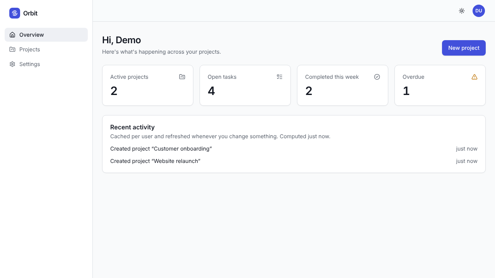
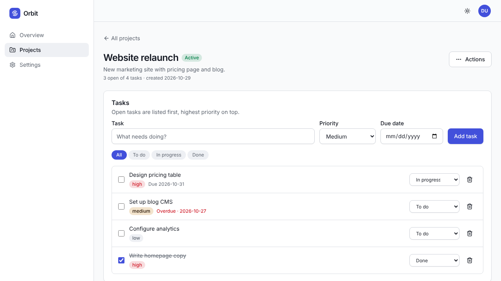
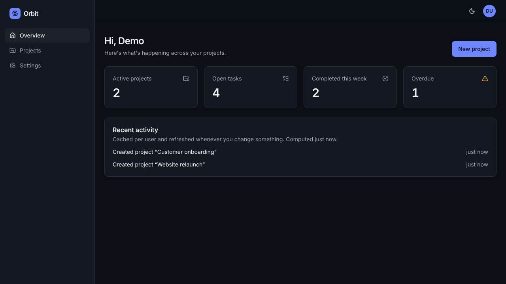
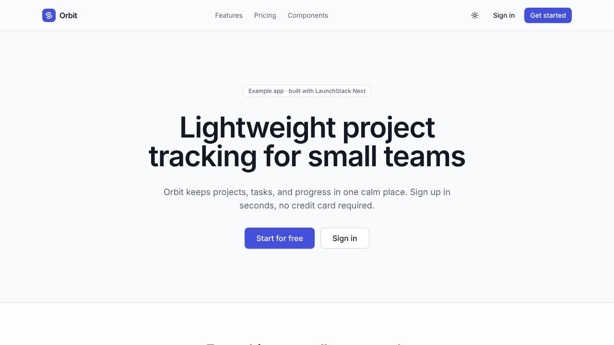
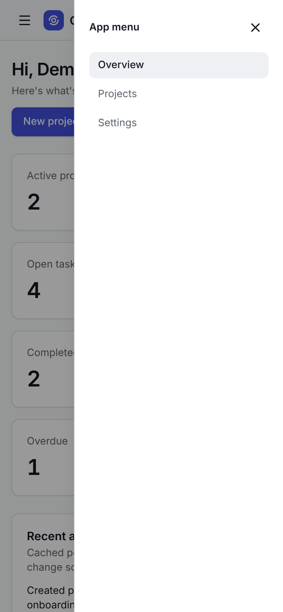

# LaunchStack Next

A production-minded **Next.js SaaS starter kit** for solo developers and small teams. It ships a small but real example product (**Orbit**, a project and task tracker) built on patterns you can copy for your own features: server-side authorization, validated APIs, typed data access, per-user caching with documented invalidation, and tests at every layer.



| | |
|---|---|
|  |  |
|  |  |

## What's inside

| Area | What you get |
|---|---|
| **Framework** | Next.js 16.4 (App Router, Turbopack, Cache Components), React 19.3, TypeScript strict mode |
| **Auth** | [Better Auth](https://www.better-auth.com) 1.7: email + password sign-up/in/out, password reset, session list and revoke, change password, delete account, DB-backed rate limits on auth endpoints |
| **Authorization** | `user` and `admin` roles, permission checks and resource policies in one tested module, ownership enforced in every service function |
| **Database** | PostgreSQL on [Neon](https://neon.tech) (recommended; local Docker Postgres also works) + [Drizzle ORM](https://orm.drizzle.team), committed SQL migrations, idempotent seed script, pooled and direct connections ([docs/neon.md](docs/neon.md)) |
| **API** | Versioned REST API (`/api/v1`) with Zod validation, one error format, pagination, filtering, search, per-user rate limits, request ids |
| **Dashboard** | Responsive app shell, overview cards, recent activity, projects + tasks CRUD, settings, admin user directory; loading, empty, error, and success states throughout |
| **UI kit** | Accessible components (button, input, select, field, modal, dropdown, table, alert, card, badge, pagination, empty state, skeleton) with light/dark design tokens; live at `/components` |
| **Production** | Env validation with readable errors, structured JSON logs with secret redaction, security headers + CSP, health check, Dockerfile, GitHub Actions CI + deploy |
| **Caching** | Worked example: per-user `'use cache'` dashboard with tag invalidation from Server Actions and Route Handlers ([docs/caching.md](docs/caching.md)) |
| **Integrations (optional, off by default)** | Email (console or Resend), payments (Stripe Checkout + verified webhooks), file storage (local disk), analytics (console or PostHog), AI (Anthropic). See [status table](docs/integrations.md#status) |
| **Tests** | Vitest unit + integration (real Postgres), Playwright end-to-end, all run in CI |

## Quick start

Requirements: **Node.js 20.9+** (22 recommended, see `.nvmrc`) and a **[Neon](https://neon.tech)** project (free tier is fine). Prefer to work offline? Use the bundled Docker Postgres instead.

```bash
npm install
npm run setup          # creates .env from .env.example and generates BETTER_AUTH_SECRET
# Neon: paste the pooled and direct connection strings into DATABASE_URL and
#       DATABASE_URL_UNPOOLED in .env (see docs/neon.md)
# or offline: docker compose up -d   (keeps the default localhost DATABASE_URL)
npm run env:check      # confirms which database you're connected to
npm run db:migrate     # creates the tables
npm run db:seed        # demo accounts + sample data (development only; use a Neon dev branch)
npm run dev            # http://localhost:3000
```

Sign in with **`demo@launchstack.dev`** (regular user) or **`admin@launchstack.dev`** (admin), password = `SEED_DEMO_PASSWORD` from your `.env` (`demo-password-123` in the example file). Seeding refuses to run with `NODE_ENV=production`, and no default password exists anywhere in production code paths.

Password reset links are printed to the terminal running `npm run dev` while `EMAIL_PROVIDER=console`.

Stuck? See [docs/installation.md](docs/installation.md#troubleshooting).

## Scripts

| Command | What it does |
|---|---|
| `npm run dev` | Development server with hot reload |
| `npm run build` / `npm start` | Production build / serve it |
| `npm run lint` | ESLint (zero warnings allowed) |
| `npm run typecheck` | Generates route types, then `tsc --noEmit` |
| `npm run test:unit` | Fast tests, no database needed |
| `npm run test:integration` | API, auth, and authorization tests against `launchstack_test` |
| `npm run test:e2e` | Playwright against a production build (run `npm run build` first) |
| `npm test` | Unit + integration |
| `npm run verify` | Lint, typecheck, unit + integration tests, build: what CI checks before e2e |
| `npm run db:generate` | Create a migration after editing `src/server/db/schema` |
| `npm run db:migrate` | Apply pending migrations (safe to run on every deploy) |
| `npm run db:seed` / `db:reset` | Demo data / drop everything and start over (local only) |
| `npm run env:check` | Validate `.env` without starting the app |
| `npm run screenshots` | Regenerate `docs/screenshots` |

## Project structure

```
src/
  app/                      Routes only: pages, layouts, route handlers
    (marketing)/            Public landing page and /components showcase
    (auth)/                 Sign in, sign up, forgot/reset password
    (app)/dashboard/        Authenticated app (overview, projects, settings, admin)
    api/v1/                 REST API, one folder per resource
  components/ui/            Reusable, accessible UI kit
  components/layout/        App shell, navigation, headers
  features/<feature>/       Feature code: Zod schemas, Server Actions, feature components
  lib/                      Client-safe helpers (auth client, formatting, safe redirects)
  config/site.ts            Product name, navigation (safe for the browser)
  server/                   Server-only code
    config/env.ts           The only place environment variables are read
    auth/                   Better Auth setup + `getViewer` / `requireViewer`
    authz/permissions.ts    Roles, permissions, resource policies (pure functions)
    services/               Business logic; every function authorizes its caller
    db/                     Drizzle schema + connection pool
    http/                   API wrapper, errors, validation, pagination, Server Action helper
    cache/                  Cached reads and their invalidation
    rate-limit/             Fixed-window limiter (Postgres or memory)
    integrations/           Email, payments, storage, analytics, AI adapters
drizzle/                    Generated SQL migrations (commit these)
scripts/                    setup, env check, migrate, seed, reset
tests/unit|integration|e2e  Test suites
docs/                       Guides (start with architecture.md)
packaging/                  License template, sales landing page (not part of the app)
```

## Documentation

- [Architecture and design decisions](docs/architecture.md)
- [Installation and troubleshooting](docs/installation.md)
- [Using Neon (database setup, branches, pooling)](docs/neon.md)
- [Environment variable reference](docs/environment-variables.md)
- [Deployment (Vercel, Docker)](docs/deployment.md)
- [Caching and revalidation](docs/caching.md)
- [Security](docs/security.md)
- [Testing](docs/testing.md)
- [UI components and theming](docs/ui-components.md)
- [Optional integrations](docs/integrations.md)
- [Adding a new feature](docs/adding-a-feature.md)
- [Upgrading dependencies safely](docs/upgrading-dependencies.md)
- [API reference](docs/api.md)
- [Feature checklist](docs/feature-checklist.md)
- [Changelog](CHANGELOG.md) and versioning policy

## What you need to configure, and what may cost money

Everything runs locally for free. For production you provide:

| You configure | Required? | Typical cost |
|---|---|---|
| A PostgreSQL database: Neon recommended ([setup](docs/neon.md)); any Postgres 14+ works | **Yes** | Neon has a free tier; paid plans are usage-based |
| Hosting (Vercel, or any Docker host) | **Yes** | Free hobby tiers exist; commercial use usually needs a paid plan |
| `APP_URL`, `BETTER_AUTH_SECRET`, `DATABASE_URL` | **Yes** | Free |
| Email delivery (Resend) for password reset in production | Strongly recommended | Free tier, then paid |
| Stripe (billing) | Optional | Per-transaction fees |
| PostHog (analytics) | Optional | Free tier, then usage-based |
| Anthropic API (AI suggestions) | Optional | Usage-based, per token |
| S3/R2-compatible storage | Optional, needs an adapter (interface provided) | Usage-based |

No optional integration is required to sign up, sign in, or use the example app.

## License

Commercial license. See [LICENSE.md](LICENSE.md). Third-party packages keep their own (mostly MIT) licenses.
