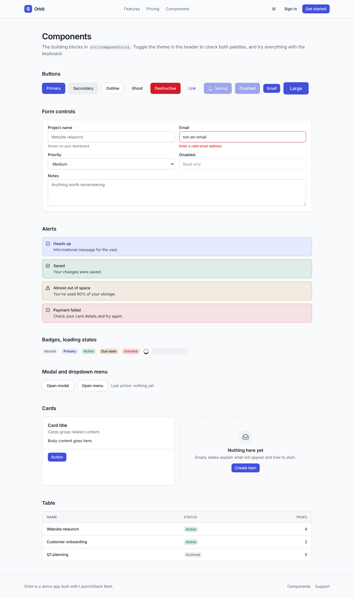

# UI components and theming

The UI kit lives in `src/components/ui`. Every component is a small, readable file you own: change it freely. A live gallery of all of them, in both themes, is at **`/components`** when the app is running.



## Principles

- **Semantic tokens only.** Components use `bg-surface`, `text-muted-foreground`, `border-border`, and so on, never raw colors, so re-theming is one CSS block.
- **Accessible by default.** Native elements where possible (`<button>`, `<select>`, `<table>`); Radix primitives for the hard parts (dialog focus trapping, menu keyboard navigation). Visible focus rings everywhere. Labels, hints and errors are wired with `aria-describedby` / `aria-invalid` automatically by `Field`.
- **Server-first.** Most components are plain Server Components. Only `Modal`, `DropdownMenu`, the theme toggle and the forms are client components, and they're imported from their own files (`@/components/ui/modal`, `@/components/ui/dropdown-menu`) so server code never pulls them in by accident.
- **No component library lock-in.** Tailwind v4 classes plus `cn()` (clsx + tailwind-merge) so callers can override any class.

## Components

| Component | Import | Notes |
|---|---|---|
| `Button`, `buttonClasses` | `@/components/ui` | Variants `primary`, `secondary`, `outline`, `ghost`, `destructive`, `link`; sizes `sm`, `md`, `lg`, `icon`. Defaults to `type="button"`. `loading` shows a spinner and sets `aria-busy`. `asChild` renders the styles on a child (e.g. a `<Link>`). |
| `Input`, `Textarea`, `Select` | `@/components/ui` | Styled native controls. |
| `Field`, `Label` | `@/components/ui` | `<Field label hint error>` wraps one control and connects label, hint and error to it. |
| `Card` (+ `CardHeader`, `CardTitle`, `CardDescription`, `CardContent`, `CardFooter`) | `@/components/ui` | Content containers. |
| `Alert` | `@/components/ui` | `info`, `success`, `warning`, `error`. Errors use `role="alert"`, others `role="status"`, so screen readers announce them appropriately. |
| `Badge` | `@/components/ui` | `neutral`, `primary`, `success`, `warning`, `danger`. |
| `Table`, `THead`, `TBody`, `TR`, `TH`, `TD` | `@/components/ui` | Scrolls horizontally on small screens; optional `caption` for screen readers. |
| `Pagination` | `@/components/ui` | Link-based (works without JavaScript), keeps the current query string. |
| `EmptyState` | `@/components/ui` | Icon, title, description and an optional action. |
| `Skeleton`, `Spinner` | `@/components/ui` | Loading states. Page-level skeletons are passed as `<Suspense fallback>` (see `dashboard-skeleton.tsx`). |
| `Avatar`, `initials` | `@/components/ui` | Initials avatar. |
| `Modal`, `ModalClose` | `@/components/ui/modal` | Radix Dialog: focus trap, Escape to close, focus returns to the trigger, `title` required (it's the accessible name). Controlled or uncontrolled. |
| `DropdownMenu`, `DropdownMenuItem`, `DropdownMenuLabel`, `DropdownMenuSeparator` | `@/components/ui/dropdown-menu` | Radix menu: arrow keys, typeahead, Escape. |

Layout pieces (`src/components/layout`): app navigation with active-link state, the mobile navigation drawer, user menu, page header, marketing header and footer.

### Example: a form field with server errors

```tsx
<Field label="Project name" error={state.fieldErrors?.name?.[0]} hint="Shown to your team">
  <Input name="name" required />
</Field>
```

## Theming

Tokens are CSS variables in `src/app/globals.css`, defined once for light (`:root`) and once for dark (`.dark`), then exposed to Tailwind with `@theme inline`. Colors use OKLCH so lightness steps are perceptually even.

To rebrand:

1. Change `--primary` / `--ring` / `--accent` (and their `-foreground` pairs) in both blocks.
2. Adjust `--radius` for rounder or sharper corners.
3. Rename the product in `src/config/site.ts` and replace `src/components/layout/logo.tsx`.

Keep text/background pairs at a WCAG AA contrast ratio of at least 4.5:1. Check both themes; the `/components` page is the quickest way.

### Light, dark and system

`ThemeScript` (an inline script in `<head>`) reads the saved choice from `localStorage` (`theme`: `light`, `dark`, or `system`) and sets the `.dark` class **before first paint**, so there's no flash of the wrong theme. `ThemeToggle` is a dropdown with the three options; `system` follows `prefers-color-scheme` and reacts when the OS setting changes.

## Keyboard and screen readers

- A "Skip to content" link is the first focusable element on every page.
- Every interactive element is reachable and operable by keyboard; the e2e accessibility test checks the skip link, menus and dialogs.
- Icon-only buttons have `aria-label`s; decorative icons are `aria-hidden`.
- The current navigation item has `aria-current="page"`.
- Optimistic task toggles update the checkbox label ("Mark … as done/not done").

Automated tests can't prove accessibility. Before shipping, test the flows you add with a keyboard only and with a screen reader (VoiceOver or NVDA).
